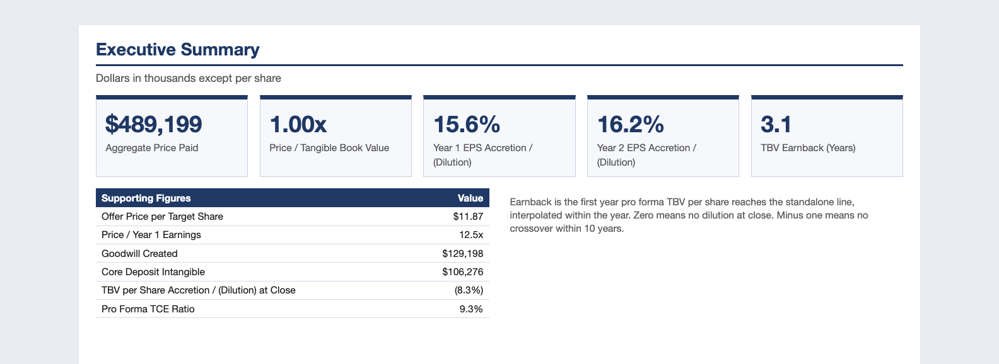
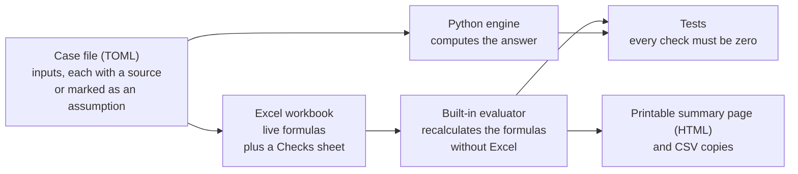
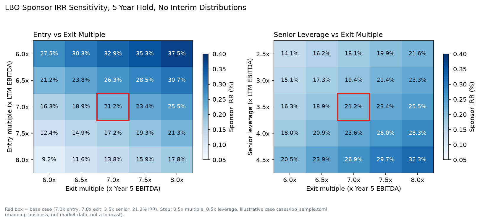
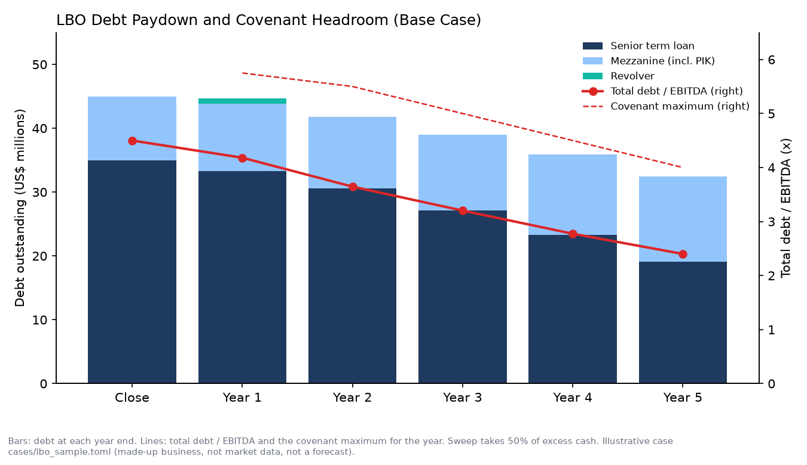
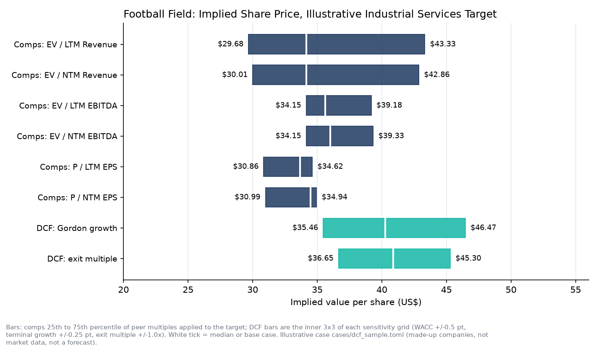
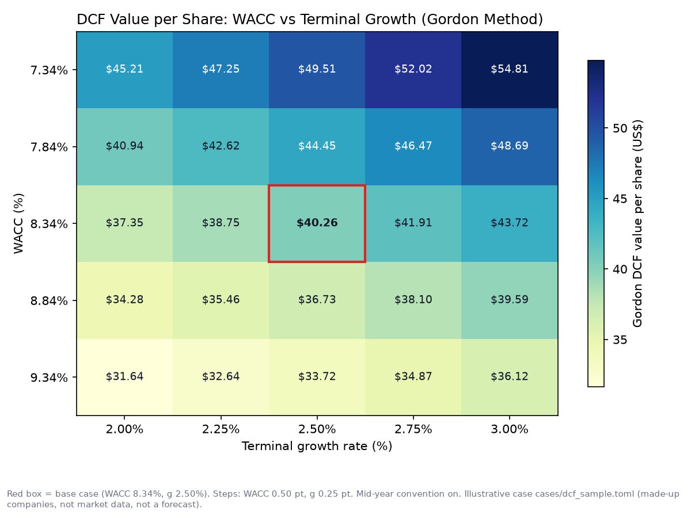

# IBToolkit

Python models for the valuation work a junior banker does: DCF, trading comps, precedent deals, LBO returns, debt capacity, bank valuation and bank merger math. Each one reads a plain-text case file and writes an Excel workbook with live formulas, so anyone can open it and see how every number was built.

The test I care about: I rebuilt a real bank merger from its public filings, and the model lands on the deal deck's **$1.98 Year 1 EPS** and **1.00x price to tangible book**. Where it doesn't match, the gap is written down below.



## How it works



The workbook is the product. The evaluator is there so the tests can prove the spreadsheet's own formulas work, without opening Excel.

## Real-deal check: Eastern Bankshares / HarborOne (announced April 2025)

I rebuilt the deal from the 8-K investor presentation and Q1 2025 earnings releases. Each input in [`cases/merger_real_eastern_harborone.toml`](cases/merger_real_eastern_harborone.toml) cites its source line or is marked as an assumption.

| Measure | My model | Deal deck |
|---|---:|---:|
| Deal value | $489.2mm | $490mm |
| Price / tangible book | 1.00x | 1.00x |
| Year 1 EPS | $1.98 | $1.98 |
| Year 1 EPS accretion | 15.6% | ~16% |
| TBV per share dilution | −8.3% | −7.3% |
| TBV earnback | 3.1 years | 2.8 years |

Reading the table:

- **Tangible book value (TBV):** a bank's equity minus goodwill and other intangibles. Bank deals are priced against it.
- **Accretion / dilution:** whether the deal raises or lowers the buyer's earnings per share (EPS), or its TBV per share.
- **Earnback:** how many years it takes TBV per share to get back to where it would have been without the deal.

**Where it doesn't match, and why.** My TBV dilution comes out a point worse. The model books the after-tax credit mark on non-PCD loans (about $32mm) against tangible book at close. The deck's $2,803mm pro forma TBV doesn't. (The credit mark is the write-down a buyer takes for loans it expects to go bad. Non-PCD loans are the ones that looked healthy at purchase.) That one item explains the gap, and it carries through to the slower earnback. I kept the difference and wrote it down instead of tuning inputs until it matched.

## Other models (illustrative cases)

**LBO.** A leveraged buyout is a purchase funded mostly with debt. The sample is a $70mm services buyout at 7.0x EBITDA with a senior term loan, PIK mezzanine (a junior loan whose interest is added to the balance, not paid in cash), a revolver, and a 50% cash sweep (half of spare cash pays the loan down early). It returns a **21.2% IRR / 2.62x MOIC**, meaning 21.2% a year and 2.62 times the money invested, with the exit multiple held flat. At a 6.0x exit, IRR drops to 16.3%.





**DCF, comps and precedents.** A DCF values a company on its future cash flows, discounted at WACC (the blended cost of its debt and equity). The model builds WACC, uses the mid-year convention, and cross-checks two terminal values (Gordon growth and exit multiple). The football field puts every method's range on one chart.





**Debt capacity.** Sizes debt against four lender limits (total leverage, senior leverage, interest coverage, FCF/debt). The tightest one sets the answer, with no goal seek.

**Bank valuation.** Reads the target's P/TBV off a peer regression of P/TBV against return on tangible equity, and runs a dividend discount model on capital above what the bank needs to hold.

**[Small business screener](smb/).** An illustrative laundromat at 2.7x SDE (the owner's total take from the business) clears the SBA lender's 1.25x coverage test at **2.22x** and returns a 29% equity IRR.

## Run it

Python 3.11+.

```bash
python3 -m venv .venv && ./.venv/bin/pip install -r requirements.txt
./.venv/bin/python -m ibtoolkit merger cases/merger_real_eastern_harborone.toml --out output/merger.xlsx
./.venv/bin/python -m ibtoolkit lbo cases/lbo_sample.toml --out output/lbo.xlsx
./.venv/bin/python -m pytest -q        # 271 tests, both IBToolkit and the screener
```

Add `--pitch FILE.html` for a printable summary page, or `--csv DIR` for CSV copies of each sheet.

## How it's checked

- Every workbook has a Checks sheet. A built-in evaluator recalculates the live formulas without Excel, and the tests confirm every check is zero and that a deliberately broken workbook trips one.
- Hand checks: the LBO value bridge sums to the equity gain exactly, and the DCF WACC matches a hand calculation.
- The HarborOne test pins each deck figure, so a change that breaks the tie-out fails the build.

## Limits

No NOL carryforward in the LBO, fixed share counts (no treasury stock method), no beta relevering, and the sample peer sets are made up, not real comparables. The charts come from `scripts/make_figures.py` (needs matplotlib). [docs/reference.md](docs/reference.md) has the full concepts, formulas, methods and validation.
