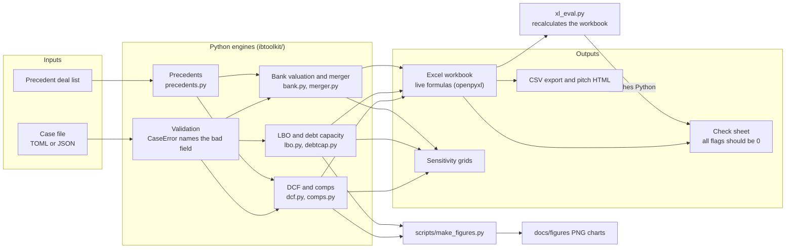
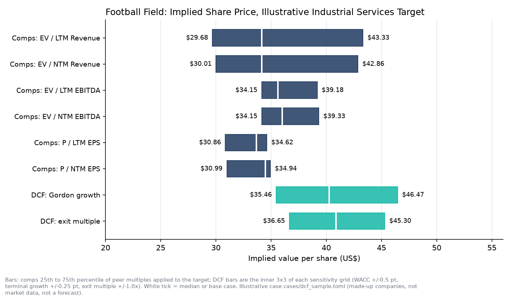
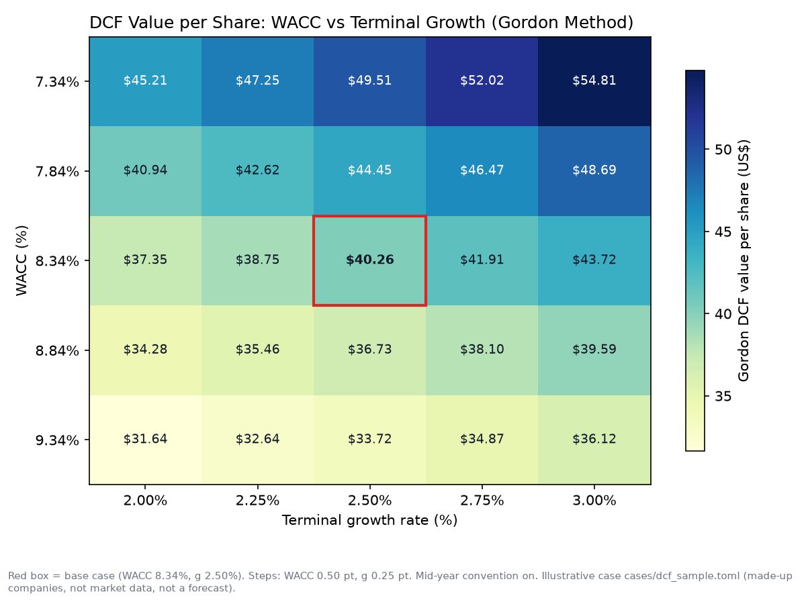
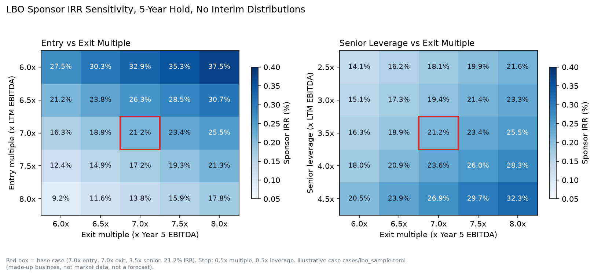
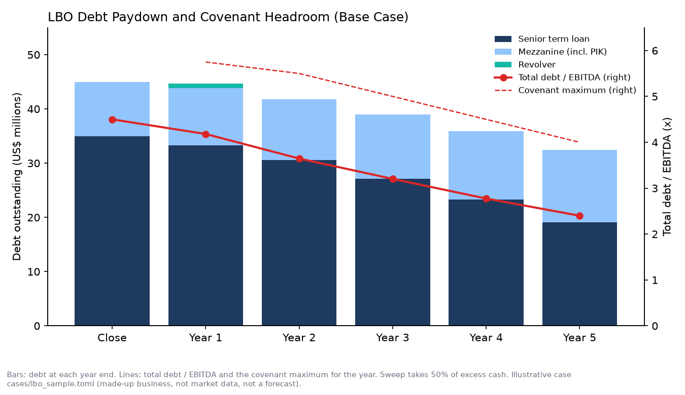
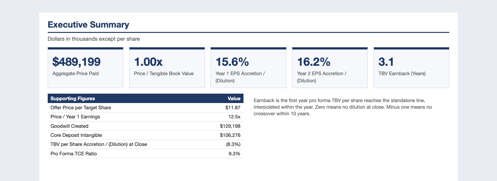

# IBToolkit: full reference

The short project overview is in the [README](../README.md). This page keeps the full detail: concepts and formulas, architecture, the worked example, methodology and validation.

Python models for the core investment banking valuation work: DCF, trading comps, precedent transactions, LBO returns, debt capacity, bank valuation, and bank merger accretion/dilution. Each case file produces a live Excel workbook and a check sheet.

## 1. Executive Summary

IBToolkit takes a plain text case file (inputs for one company or one deal) and produces two things: the answer, and a spreadsheet that shows how the answer was built. The Python engines calculate the valuation, returns or deal math. A matching Excel workbook is written with live formulas, and a checker recalculates that workbook to confirm it agrees with the Python. The toolkit covers the models a banker builds in a valuation or deal process, and it puts the reasoning in the open: every assumption is a labeled input, every output has a check, and the sensitivity tables show how far each answer moves when an assumption moves. All sample companies and deals in the repository are made up or illustrative, and nothing in this README is market data or an investment view.

## 2. Key Concepts

**Discounted cash flow (DCF).** A DCF values a company as the present value of the cash it will generate. Unlevered free cash flow (UFCF) is the operating cash after tax and reinvestment, before any interest, so it belongs to all capital providers. Those cash flows are discounted at the weighted average cost of capital (WACC), the blended return that debt and equity investors require. Mid-year discounting assumes cash arrives evenly through each year, so the year 1 cash flow is discounted 0.5 years.

```text
UFCF = EBIT - tax + D&A - capex - increase in NWC
WACC = E/(D+E) x Cost of equity + D/(D+E) x Pre-tax cost of debt x (1 - tax rate)
Cost of equity (CAPM) = Risk-free rate + Beta x Equity risk premium
Gordon terminal value = UFCF(N) x (1 + g) / (WACC - g)
Exit terminal value = Exit multiple x EBITDA(N)
```

The terminal value is the value of everything after year 5, and it usually makes up most of the enterprise value. The toolkit therefore computes two versions and cross-checks them: the exit multiple implies a perpetual growth rate, and the Gordon growth formula implies an exit multiple. If the two disagree, one assumption is inconsistent.

**Trading comps.** Comparable company analysis values the target by applying the multiples that similar listed companies trade at. Enterprise value (EV) is the market value of the equity plus net debt, so it is the price of the whole business before capital structure. EV/EBITDA and EV/Revenue compare EV with operating earnings or sales, and P/E compares share price with earnings per share. The toolkit reports the 25th percentile, median and 75th percentile of the peer multiples, which gives a range instead of one number.

```text
Enterprise value = Share price x Shares + Net debt
Implied target EV = Peer multiple x Target metric   (equity = EV - net debt)
Implied price per share = Implied equity / Diluted shares
```

**Precedent transactions.** Precedent analysis applies the multiples paid in past acquisitions of similar companies. Those multiples include a control premium, the extra price a buyer pays to own the whole company, so they usually sit above trading comps. The toolkit can filter deals by age, and it skips any metric with fewer than three deals.

**LBO returns.** A leveraged buyout (LBO) is a purchase funded mostly with debt, with the sponsor (private equity firm) putting in the rest as equity. Returns come from three sources: growth in EBITDA, paying down debt from cash flow, and any change in the valuation multiple between entry and exit. Internal rate of return (IRR) is the annual return that equates the equity invested with the equity received at exit. Multiple of invested capital (MOIC) is the total return as a multiple of the money put in.

```text
Sponsor equity = Total uses - Senior debt - Mezzanine debt
Exit equity = Exit multiple x EBITDA(5) - Debt(5) + Cash(5)
MOIC = Sponsor proceeds / Sponsor equity
IRR = MOIC^(1/5) - 1        (one entry, one exit, no interim distributions)
```

The debt schedule matters as much as the returns. Interest is charged on the opening balance each year. Mandatory amortization is a fixed repayment of principal. A cash sweep uses a share of the cash left over to prepay the term loan. A revolver covers any cash shortfall below a minimum balance. Covenants are lender tests: maximum total leverage (debt divided by EBITDA) and minimum interest coverage (EBITDA divided by cash interest), tested each year.

**Debt capacity.** Debt capacity asks how much debt a company can carry under the limits lenders set. The toolkit tests four limits: total leverage, senior secured leverage, interest coverage, and free cash flow to debt. Each limit has a closed-form answer, so the maximum debt is the smallest of the four with no goal seek. Lenders size leverage on covenant EBITDA, which is reported EBITDA plus add-backs (one-time costs and synergies the credit agreement allows), with the add-backs capped at a percentage of reported EBITDA.

```text
Max debt (leverage) = Max leverage x Covenant EBITDA
Max debt (coverage) = EBITDA / (Min coverage x Blended interest rate)
Max debt (FCF/debt) = Year 1 cash flow / (Min FCF-to-debt + Blended interest rate)
Max debt = minimum of the four
```

**Bank valuation.** Banks are valued on book value and earnings rather than enterprise value, because a bank's debt is its raw material. Price to tangible book value (P/TBV) is compared with return on tangible common equity (ROTCE), since a bank that earns more on its equity deserves a higher multiple. The toolkit fits a line through peer P/TBV against peer ROTE and reads the target's implied multiple from it. A dividend discount model (DDM) values the bank on the cash it can distribute above the capital it needs.

```text
Implied P/TBV = Regression intercept + Slope x Target ROTCE
Gordon distribution (year 5+) = NI(5) x (1 + g) - g x TCE(5)
DDM value = PV of distributions + PV of terminal value
```

**Bank merger accretion and dilution.** A bank merger is accretive if the combined company's earnings per share (EPS) rise, and dilutive if they fall. Accretion depends on the price paid, the mix of cash and stock, cost savings and the one-time marks the buyer records on the target's balance sheet. Tangible book value (TBV) dilution is the other test: the bank is tested on how long it takes the TBV per share lost at close to be earned back. The toolkit also solves for the cost saves that would make year 1 EPS exactly break even.

```text
Goodwill = Purchase price - Fair value of net assets
Pro forma TBV = Acquirer TBV + Target TBV + Net marks x (1 - t) - Cash consideration - After-tax charges
Accretion (%) = Pro forma EPS / Standalone EPS - 1
Breakeven cost saves = Modeled saves - (PF EPS - SA EPS) x PF shares / (1 - t)
```

## 3. Architecture



## 4. Worked Example

Illustrative LBO on a made-up lower middle market services business (`cases/lbo_sample.toml`). All figures are illustrative, not market data or a forecast. Money is in $ thousands unless marked as millions.

**Inputs**

| Input | Value |
|---|---|
| LTM revenue / LTM EBITDA | $60.0M / $10.0M (16.7% margin) |
| Entry and exit multiple | 7.0x LTM EBITDA, 7.0x Year 5 EBITDA |
| Revenue growth, Years 1 to 5 | 6%, 6%, 5%, 5%, 4% |
| EBITDA margin, Years 1 to 5 | 16.8%, 17.0%, 17.2%, 17.4%, 17.5% |
| Senior term loan | 3.5x EBITDA, 9.0% rate, 5% amortization, 50% cash sweep |
| Mezzanine | 1.0x EBITDA, 6.0% cash plus 6.0% PIK |
| Revolver | $5.0M commitment, 8.5% rate, $3.0M minimum cash |
| Advisory fee / financing fee | 2.0% of price / 2.5% of debt plus revolver commitment |
| Tax rate | 25% |

**Step 1: Sources and uses at close**

- Purchase price: 7.0 x $10.0M = $70.00M
- Advisory fee: 2.0% x $70.00M = $1.40M
- Financing fee: 2.5% x ($35.0M + $10.0M + $5.0M) = $1.25M
- Total uses: $72.65M
- Senior debt $35.00M + mezzanine $10.00M, so sponsor equity = $72.65M - $45.00M = **$27.65M** (38% of sources)

**Step 2: Operations and cash flow**

- Year 5 revenue $77.3M and EBITDA $13.53M (17.5% margin)
- Free cash flow after interest and tax: $3.92M in Year 1, rising to $6.59M in Year 5

**Step 3: Debt and cash**

- Year 1 revolver draw of $0.83M to hold the $3.0M minimum cash, repaid in Year 2
- Senior term loan falls from $35.00M to $19.08M
- Mezzanine grows from $10.00M to $13.38M through PIK interest
- Cash builds to $10.17M by Year 5, because the sweep takes only half of excess cash

**Step 4: Exit (Year 5)**

- Exit enterprise value: 7.0 x $13.53M = $94.69M
- Less debt of $32.47M, plus cash of $10.17M
- Exit equity = **$72.39M**

**Step 5: Returns**

- MOIC = $72.39M / $27.65M = **2.62x**
- IRR = 2.62^(1/5) - 1 = **21.2%**

**Step 6: Value creation bridge** (sums to exit equity less entry equity)

| Source | $M |
|---|---|
| EBITDA growth at the entry multiple | +24.69 |
| Multiple change (7.0x in, 7.0x out) | 0.00 |
| Debt paydown and cash build | +22.70 |
| Fees paid at close | -2.65 |
| **Total = $72.39M - $27.65M** | **+44.74** |

**Step 7: Credit tests**

- Total debt / EBITDA: 4.50x at close, 4.18x in Year 1 against a 5.75x maximum (27% headroom), 2.40x in Year 5
- Year 1 interest coverage 2.83x against a 1.75x minimum
- Year 1 fixed charge coverage 1.46x, after capex, cash tax and mandatory amortization
- No covenant failures in any year

**Interpretation.** The 21.2% IRR comes from EBITDA growth and debt paydown, not from a higher exit multiple, which is held flat at 7.0x. If the exit multiple falls to 6.0x, the IRR falls to 16.3% (sensitivity grid in Section 5), so the answer depends most on the exit multiple and the margin path, which should be tested before anyone relies on the number.

Reproduce these numbers with the one command in Section 8. The figures are regenerated from the same engines.

## 5. Visuals

The four charts are generated by `scripts/make_figures.py` from the sample cases, and the last image is a page of the merger pitch book. Every value on them is computed by the Python engines.

**Football field.** The implied value per share for each method on the illustrative industrial services target (`cases/dcf_sample.toml`).



*Bars are the 25th to 75th percentile of peer multiples for the comps, and the inner 3x3 of each DCF sensitivity grid. Assumptions: illustrative made-up companies, WACC 8.34%, terminal growth 2.50%, exit multiple 10.5x, mid-year convention on.*

**DCF sensitivity.** Gordon growth value per share across WACC and terminal growth.



*Value per share in US$. Steps: WACC 0.50 point, terminal growth 0.25 point. Assumptions: illustrative inputs, mid-year convention, the base case is boxed. Moving WACC by 0.5 point moves the Gordon value by about $3.50 to $4.20 per share.*

**LBO returns sensitivity.** Sponsor IRR across entry and exit multiples (left) and senior leverage and exit multiple (right).



*Sponsor IRR over a 5-year hold with no interim distributions. Steps: 0.5x multiple, 0.5x leverage. Assumptions: illustrative LBO case (`cases/lbo_sample.toml`), exit multiple and entry multiple as stated, all other inputs as in Section 4.*

**LBO debt paydown.** Debt outstanding by tranche and total leverage against the covenant maximum, base case.



*Debt in US$ millions at each year end, and total debt / EBITDA on the right axis. Assumptions: illustrative LBO case, 50% cash sweep, covenant maximums stepping down from 5.75x to 4.00x.*

**Real-deal check: Eastern Bankshares / HarborOne Bancorp.** The executive summary page of the bank merger pitch book, run on the deal announced April 24, 2025.



*Dollars in thousands except per share. Model output from public inputs in `cases/merger_real_eastern_harborone.toml` (8-K investor presentation and Q1 2025 earnings releases, cited line by line in the case file). It is the model's estimate, not the companies' reported figures. Regenerate with `python -m ibtoolkit merger cases/merger_real_eastern_harborone.toml --pitch output/pitch.html`.*

## 6. Methodology and Assumptions

- **Units.** DCF and comps are in $ millions; LBO, debt capacity and merger are in $ thousands; the bank model is in $ millions. Each sheet states its units.
- **Conventions.** LBO interest runs on opening balances, so there is no circular reference. DCF uses a mid-year convention by default, with the exit multiple discounted from year end. Cash taxes are on positive pre-tax income only, with no tax credit on losses.
- **Known simplifications** (the code is explicit about these): no NOL carryforward in the LBO; no treasury stock method, so share counts are fixed; no beta relevering, so the peer beta is used as given; WACC has no size premium; LBO IRR assumes no interim distributions; debt capacity uses the case's cash taxes instead of recalculating them after interest.
- **Covenants** are tested as inputs. Defaults are set so an untested case shows no covenant failures.
- **Bank cases** use public filings for the real examples and clearly labeled assumptions elsewhere. Sample peer sets are illustrative, not a list of real bank comparables.
- **Precedent multiples** are inputs as reported by the source (press release, 8-K or proxy). A deal with no figure for a metric is left out of that metric's statistics.

## 7. Validation

- **Python against workbook.** Each case builds a workbook with live formulas. `xl_eval.py` recalculates those formulas without Excel, and the integrity tests check that every check flag is 0 on the sample cases and that a deliberately broken workbook trips a check.
- **Hand checks.** The LBO value creation bridge sums exactly to exit equity less entry equity (24.69 + 0.00 + 22.70 - 2.65 = 44.74). IRR equals MOIC^(1/5) - 1 for the single-exit case. DCF WACC equals 0.75 x 9.50% + 0.25 x 4.875% = 8.34%.
- **Reference conventions.** The DCF follows the mid-year and terminal value conventions in Rosenbaum and Pearl, *Investment Banking: Valuation, LBOs, M&A, and IPOs*. Percentiles match Excel `PERCENTILE.INC`.
- **Tests.** Run the full suite:

```bash
./.venv/bin/python -m pytest -q
```

## 8. Quick Start

Requires Python 3.11 or newer (developed on 3.13).

```bash
cd IBToolkit
python3 -m venv .venv
./.venv/bin/pip install -r requirements.txt
./.venv/bin/pip install -r requirements-figures.txt   # matplotlib, for the charts only

# One command: prints the worked example in Section 4 and regenerates docs/figures/*.png
./.venv/bin/python scripts/make_figures.py
```

Build a workbook from any case (writes `output/` and is git-ignored):

```bash
./.venv/bin/python -m ibtoolkit lbo cases/lbo_sample.toml --out output/lbo.xlsx
./.venv/bin/python -m ibtoolkit dcf cases/dcf_sample.toml --out output/dcf.xlsx
```

The same command accepts `--csv DIR` for CSV copies of each sheet and `--pitch FILE.html` for a printable page.
