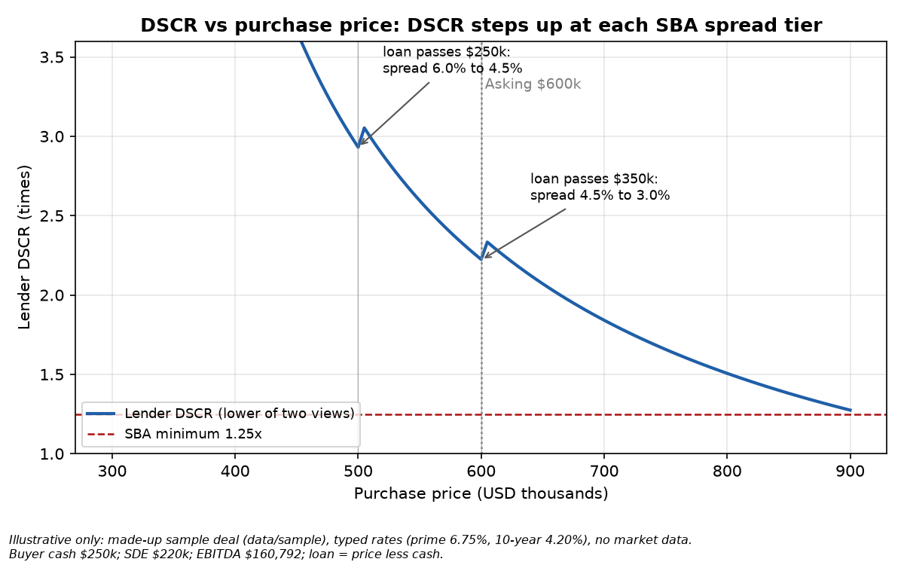
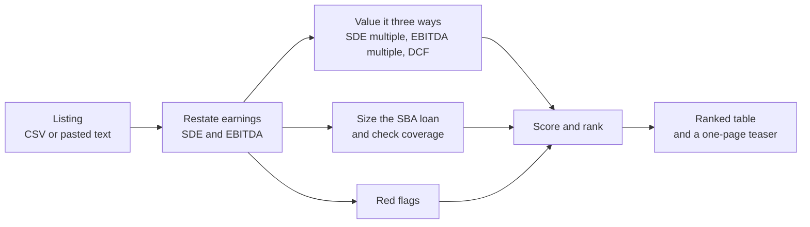
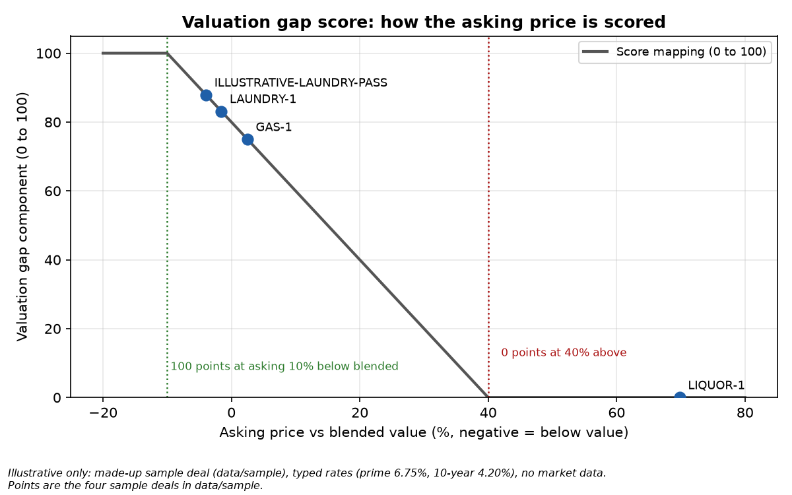
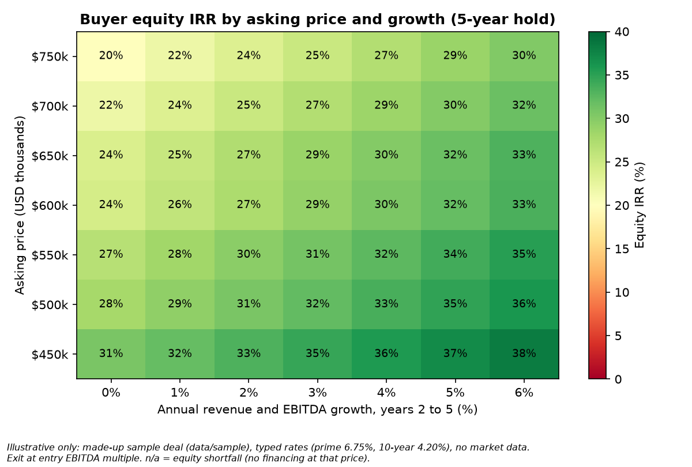

# Small Business Acquisition Screener

Part of [IBToolkit](../README.md). It screens small, cash-flowing Texas businesses for sale (gas stations, laundromats, car washes, liquor stores) the way a buyer and an SBA lender would: what does the business really earn, what is it worth, and can it carry the loan?

On the sample deals (all made up), the top pick is a $600,000 laundromat that covers its loan payments **2.22 times over** against the lender's 1.25x minimum.



## How it works



The terms:

- **SDE (seller's discretionary earnings):** what one working owner could take home. Profit plus the owner's salary, interest, depreciation and one-time or personal expenses run through the business.
- **EBITDA here:** SDE minus the cost of hiring a manager to do the owner's job.
- **DSCR (debt service coverage ratio):** yearly cash flow divided by yearly loan payments. SBA lenders want at least 1.25x.
- **SBA 7(a):** the standard government-backed loan for buying a small business.
- **IRR:** the yearly return on the cash the buyer puts in.

## The result (illustrative laundromat, asking $600,000)

- **Earnings:** owner earnings (SDE) of **$220,000**. EBITDA after paying a manager is $160,793.
- **Value:** a blend of SDE multiple, EBITDA multiple and DCF gives **$624,632**. The asking price is 3.9% below it.
- **Loan:** a $350,000 SBA 7(a) loan at 11.25% costs $58,451 a year. Coverage is **2.22x** on the stricter owner view, against the lender's 1.25x minimum.
- **Return:** $257,875 of buyer equity grows to about a **29% IRR (2.81x)** over five years, if revenue grows 3% a year and the exit is at the entry multiple.
- It ranks first of the four sample deals and gets a one-page teaser.

How the asking price gets scored against the blended value, with the four sample deals on the line:



How the buyer's return moves with the asking price and growth:



## Run it

From the IBToolkit root:

```bash
PYTHONPATH=smb/src python3 -m biz_screener.cli screen smb/data/sample/sample_listings.csv
```

The main `pytest` run in IBToolkit covers these tests too. `python3 smb/scripts/make_figures.py` re-prints the worked example and rebuilds the charts (needs matplotlib).

## What I fixed along the way

- SBA spread tiers didn't match at the exact band edges, and the loan size was being silently capped. Both are fixed and tested.
- Customer-concentration inputs outside 0 to 1 are now rejected instead of scored.

All deals in `data/sample/` are made up. Full concepts and methods: [docs/reference.md](docs/reference.md).
