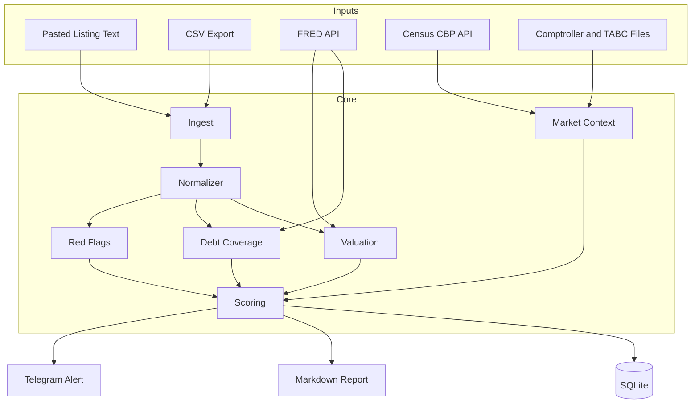

# Architecture

## Components

| Component | Responsibility |
|---|---|
| Ingest | Parses pasted text and CSV rows into listing records, validates types and units |
| Normalizer | Builds seller SDE and buyer EBITDA from reported profit, add-backs and manager salary |
| Valuation | Industry multiples, DCF and the blended value |
| Debt | SBA 7(a) loan sizing, monthly payment, DSCR at the FRED prime rate |
| Rates Client | Fetches DPRIME and DGS10 from FRED; no fallback, an unavailable or stale rate stops the run |
| Context Client | Loads Census CBP, Comptroller and TABC context by county and NAICS |
| Red Flags | Rule engine that returns flags with severity and the evidence used |
| Scoring | Weighted score, penalties from red flags, ranking |
| Storage | SQLite persistence, listing history, run log |
| Reporting | Markdown report per run and a Telegram summary |
| CLI | Command entry points for import, screen, rank, report and alert |

## Data Flow

## Module Responsibilities

| Module | Job |
|---|---|
| `config.py` | Load `config/settings.toml`, read keys from `.env`, validate ranges |
| `models.py` | Dataclasses for listings, financial periods, add-backs, valuations, scores |
| `ingest.py` | Parse paste and CSV into `Listing` objects with a parse report |
| `normalize.py` | Compute SDE and EBITDA, enforce add-back caps, log each add-back |
| `multiples.py` | Apply industry SDE and EBITDA ranges to normalized earnings |
| `dcf.py` | Project cash flow, discount rate build-up, terminal value |
| `sba.py` | Loan amount, PMT, DSCR, spread lookup by loan size |
| `fred.py` | FRED client for DPRIME and DGS10; raises on failure or stale data |
| `census_cbp.py` | Census CBP client by county and NAICS |
| `tx_context.py` | Comptroller and TABC file readers |
| `red_flags.py` | Rule definitions and evaluation |
| `scoring.py` | Component scores, weights, penalties, ranking |
| `storage.py` | SQLite schema, upserts, price history queries |
| `report.py` | Markdown report and Telegram message text |
| `alerts.py` | Telegram send with retry and dedupe |
| `cli.py` | Argument parsing and command dispatch |

## Storage

SQLite file at `data/biz_screener.db` (git-ignored through the `data/*.db` rule).

| Table | Columns |
|---|---|
| `listings` | id (integer primary key), source (text), external_ref (text, nullable), category (text), county_fips (text), asking_price (real), first_seen (text, ISO date), last_seen (text, ISO date), status (text) |
| `listing_snapshots` | id, listing_id (foreign key), captured_on (text), asking_price (real), notes (text) |
| `financial_periods` | id, listing_id, fiscal_year (integer), revenue (real), pretax_income (real), reported_sde (real), is_stated (integer, 0 or 1) |
| `add_backs` | id, listing_id, fiscal_year (integer), label (text), amount (real), category (text), source_note (text) |
| `normalized` | id, listing_id, fiscal_year (integer), sde (real), ebitda (real), addback_ratio (real) |
| `valuations` | id, listing_id, run_id, sde_value (real), ebitda_value (real), dcf_value (real), blended_value (real), discount_rate (real) |
| `debt_runs` | id, listing_id, run_id, loan_amount (real), rate (real), term_years (integer), annual_payment (real), dscr_ebitda (real), dscr_sde (real) |
| `context_snapshots` | id, county_fips (text), naics (text), year (integer), establishments (integer), employees (integer), payroll (real), source (text) |
| `red_flags` | id, listing_id, run_id, code (text), severity (text), evidence (text) |
| `scores` | id, listing_id, run_id, component (text), points (real), total (real), rank (integer) |
| `runs` | id, started_at (text), finished_at (text), inputs_hash (text), fred_stale (integer), cbp_stale (integer) |
| `alerts_sent` | id, listing_id, run_id, sent_at (text), score (real) |

## Scheduling

- **Primary:** a launchd agent runs a weekly `screen` and `alert` job on the Mac mini, after the weekly saved-search export is dropped into `data/raw/inbox/`.
- **Fallback:** a cron line with the same command, for machines without launchd.
- Scheduled runs read `.env`, write the run log, and exit with a non-zero code on any hard failure so the alert job can report it.
- No cloud scheduler and no CI.

## Alerting

- Telegram bot, one private chat.
- A message is sent when a listing scores at or above `alerts.min_score_for_alert` and has not been alerted before.
- Each message holds the name, category, county, asking price, SDE multiple, DSCR, top score drivers and the top two red flags.
- Failures are retried twice with backoff, then logged. No alert text includes full financial statements.

## Failure Handling

- FRED unavailable, maintenance page, bad file, or latest DPRIME or DGS10 value more than 10 days old with `--live-rates`: the rate is unknown, the run stops with an error and non-zero exit, and nothing is scored, saved or alerted. The `fred_stale` column is always 0 in saved runs.
- Market context data not built: the component is dropped, the other weights are rescaled to the same total, and reports note it.
- Census timeout: reuse the last cached county data and set `cbp_stale`.
- Parse failure on one row: keep the row in a rejects file with the reason, continue the batch.
