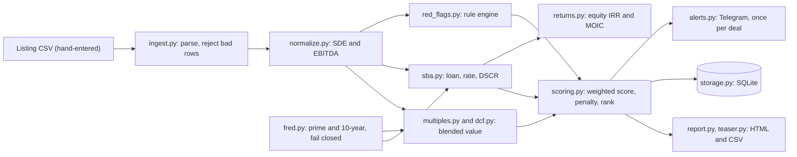
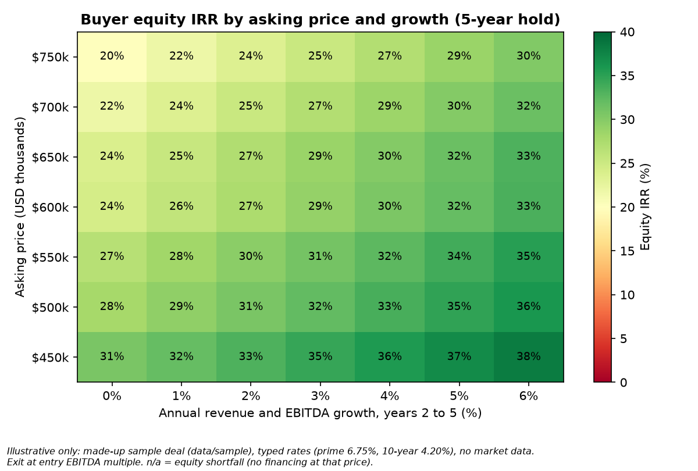
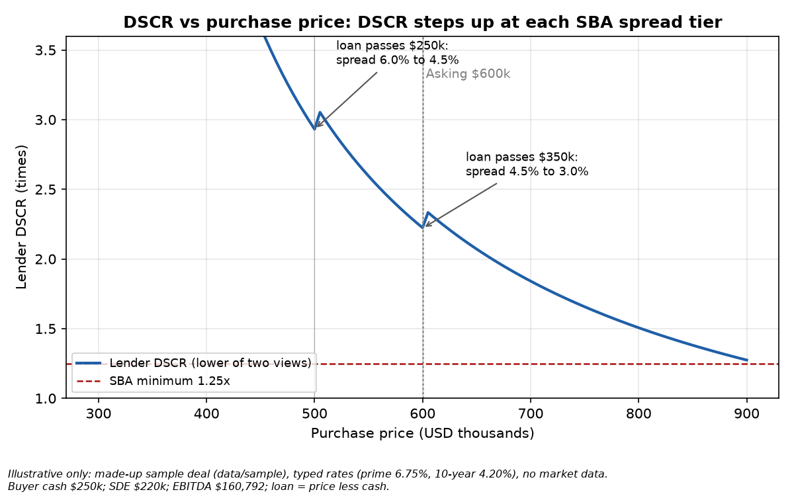
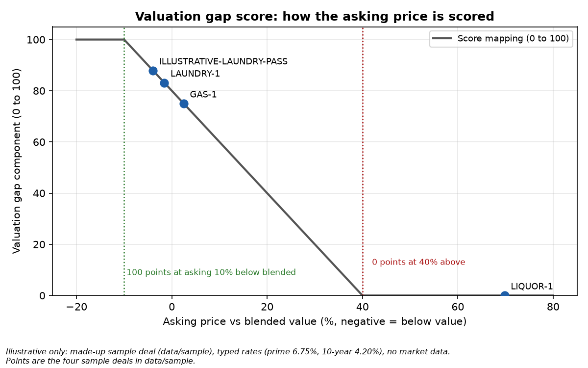

# Small Business Acquisition Screener: full reference

The short project overview is in the [README](../README.md). This page keeps the full detail: concepts and formulas, architecture, the worked example, methodology and validation.

A local Python tool that screens small, cash-flowing Texas businesses for sale (gas stations, liquor stores, laundromats, car washes) and ranks them on value, debt coverage and risk.

## 1. Executive summary

Buying a small business is mostly a question of how much cash the business really throws off and whether a bank will lend against it. This tool takes a listing's financials (from a broker sheet, pasted or exported to CSV by hand), restates the seller's profit into the cash an owner could actually take home, and then answers four questions for each deal: what is it worth (three ways), can an SBA 7(a) loan be sized and serviced at the asking price, what would the buyer earn on the cash put in, and what red flags apply. Each deal gets a transparent score and a Passes or Blocked status with plain-English reasons, so a pile of listings becomes a short list where every number can be traced. All figures in this README are illustrative, built from a made-up deal in `data/sample/`.

## 2. Key concepts

**SDE (seller's discretionary earnings).** The profit one working owner could take home: pre-tax income plus interest, depreciation, amortization, the owner's salary and one-time or personal expenses (add-backs). It is the common earnings measure for owner-run businesses under about $5 million.

$$\text{SDE} = \text{Pre-tax income} + \text{Interest} + \text{D\&A} + \text{Owner salary} + \sum \text{Add-backs}$$

**EBITDA (buyer view).** Earnings before interest, taxes, depreciation and amortization, after paying a market-rate manager. A buyer who will not work in the business has to pay someone to run it, so this view is the stricter one. The manager's salary carries employer payroll tax (7.65 percent FICA here).

$$\text{EBITDA} = \text{SDE} - \text{Manager salary} \times (1 + 0.0765)$$

**Multiple.** A price divided by earnings. Small businesses trade at a multiple of SDE (here a range per industry, midpoint used). Value by SDE is SDE times the multiple.

**DCF (discounted cash flow) and Gordon growth terminal value.** Project five years of unlevered cash flow, discount each year back to today at a required return, then add a terminal value for everything after year five, using the Gordon growth formula (a growing perpetuity).

$$V = \sum_{t=1}^{5} \frac{CF_t}{(1+r)^t} + \frac{CF_5 (1+g)}{(r-g)(1+r)^5}$$

**Discount rate (build-up).** The return a buyer requires: a risk-free rate (10-year Treasury, typed or pulled from FRED), plus a premium for size and illiquidity (small private firms are hard to sell), plus an industry premium. The sample uses 4.20 + 14 + 4 = 22.2 percent.

**SBA 7(a) loan.** A government-guaranteed bank loan for small acquisitions. Equity injection is the buyer's own cash (plus limited standby seller-note credit), at least 10 percent of the price. The loan is priced at prime plus a spread that depends on loan size, and it runs up to 10 years for a business purchase. The lender also charges an upfront guarantee fee.

$$\text{Loan} = \text{Price} - \text{Cash equity} \qquad \text{PMT} = \frac{L \cdot j}{1-(1+j)^{-n}}, \quad j = \frac{i}{12},\ n = 12T$$

**DSCR (debt service coverage ratio).** Cash flow divided by the year's loan payments. Lenders want at least 1.25x on historical numbers. This tool checks two views and uses the lower one: EBITDA (buyer pays a manager) and SDE less the owner's living draw.

$$\text{DSCR} = \frac{\text{Cash flow available}}{\text{Annual debt service}}$$

**Equity IRR and MOIC.** What the buyer earns on the cash put in. IRR is the annual rate that makes the cash in and out net to zero; MOIC (multiple on invested capital) is total cash back divided by cash in. The model holds for five years, keeps the cash left after loan payments, and sells at the same EBITDA multiple paid at entry, repaying the remaining loan.

$$0 = -E_0 + \sum_{t=1}^{5} \frac{CF^{\text{equity}}_t}{(1+\text{IRR})^t}, \qquad \text{MOIC} = \frac{\sum_t CF^{\text{equity}}_t}{E_0}$$

**Valuation gap score.** How far the asking price sits from the blended value (a 0.5 / 0.3 / 0.2 weighting of SDE value, DCF value and EBITDA value). Full points at 10 percent below blended value, zero at 40 percent above.

**Red flags and penalty.** Rules such as add-backs above 40 percent of pre-tax income, two straight years of revenue decline, one customer above 20 percent of revenue, or a lease with under 5 years left. Each flag costs 5 points, capped at 20. A high-severity flag blocks the deal outright.

## 3. Architecture



The pipeline is pure functions over dataclasses (`models.py`), driven by one TOML settings file. Market context from Census and Texas sources is planned but not built, so its scoring weight is dropped and the rest are rescaled.

## 4. Worked example (illustrative, made-up deal)

Source: `SAMPLE-ILLUSTRATIVE-LAUNDRY-PASS` in `data/sample/sample_listings.csv`. Settings: `config/settings.example.toml`. Typed rates: prime 6.75 percent, 10-year 4.20 percent.

**Inputs (FY2024, laundromat, asking $600,000)**

| Input | Amount |
|---|---|
| Revenue | $550,000 |
| Pre-tax income | $160,000 |
| Depreciation | $15,000 |
| Owner salary | $40,000 |
| Add-backs (one-time) | $5,000 |
| Manager salary (industry default) | $55,000 |
| Top customer share / lease years left | 4% / 10 |
| Buyer cash equity (settings) | $250,000 |

**Intermediate steps**

1. **SDE** = 160,000 + 15,000 + 40,000 + 5,000 = **$220,000** (2.73x the asking price).
2. **EBITDA** = 220,000 - 55,000 x 1.0765 = **$160,792.50**.
3. **Multiples** (midpoints: SDE 3.0x, EBITDA 4.0x): value by SDE = $660,000; value by EBITDA = $643,170.
4. **DCF** at 22.2 percent, five years, growth 3 percent, tax 24 percent, capex 12 percent of EBITDA: cash flow runs $106,507 (year 1) to $119,423 (year 5), so DCF value = **$553,327**.
5. **Blended value** = 0.5 x 660,000 + 0.3 x 553,327 + 0.2 x 643,170 = **$624,632**. Asking is 3.9 percent below it.
6. **Loan** = 600,000 - 250,000 = **$350,000**. That loan size falls in the $250k to $350k spread tier (4.5 percent), so the rate is 6.75 + 4.5 = **11.25 percent**. Monthly payment about $4,871, annual debt service **$58,451**.
7. **DSCR**: EBITDA view 160,792.50 / 58,451 = 2.75x; owner view (220,000 - 90,000) / 58,451 = 2.22x. The lender test uses the lower value, **2.22x**, against a 1.25x minimum.
8. **Guarantee fee** = 3 percent of the 75 percent guaranteed portion of $350,000 = $7,875, added to the buyer's equity.
9. **Equity return** (5 years, exit at the entry multiple): equity in $257,875; year-1 cash after debt service $48,056; exit value 600,000 x 1.03^4 = $675,305; less remaining loan $222,749 gives exit equity $452,557. Result: **IRR 29.0 percent, MOIC 2.81x**.
10. **Score**: valuation gap 87.9, DSCR 81.6, revenue trend 98.8, concentration 100, data quality 100, operational risk 100. Market context (15 points) is not built, so the other weights are rescaled by 100/85. Total **91.9**, no red flags.

**Outputs:** Passes screening; ranked first of four sample deals; teaser in `docs/sample-teaser/01-SAMPLE-ILLUSTRATIVE-LAUNDRY-PASS.html`.

**Interpretation:** At 2.7 times SDE, this illustrative laundromat clears the bank's coverage test with room to spare, so the price looks financeable. The 29 percent IRR rests on the stated inputs: it assumes 3 percent growth and the same exit multiple, and it leaves out closing costs and working capital, which would lower it.

The step-by-step output is printed by `scripts/make_figures.py` (section 8).

## 5. Visuals

All three charts are from the same made-up sample deal and typed rates. They are illustrative, not market data.

**Figure 1. Buyer equity IRR by asking price and growth.** Each cell rebuilds the SBA loan at that price (cash fixed at $250k) and the five-year equity cash flows.



*Axes: asking price in USD thousands (rows); annual growth in percent (columns). Colour: equity IRR in percent. Assumptions: exit at entry EBITDA multiple, 10-year SBA loan, prime 6.75 percent. n/a means no financing structure at that price.*

**Figure 2. Lender DSCR vs purchase price.** Shows how the SBA spread tiers make DSCR step up at each tier boundary, not fall smoothly.



*Axes: purchase price in USD thousands (x); lender DSCR in times (y). Dashed line: 1.25x SBA minimum. Assumptions: buyer cash $250k, SDE $220k, EBITDA $160,792, prime 6.75 percent. Each step is where the loan crosses a spread tier and the whole loan moves to the lower rate.*

**Figure 3. Valuation gap score.** The score curve and the four sample deals placed on it.



*Axes: asking price vs blended value in percent (x); valuation gap component from 0 to 100 (y). Assumptions: blended value uses the 0.5 / 0.3 / 0.2 weights and typed rates. The four points are the sample deals in `data/sample/`.*

## 6. Methodology and assumptions

- **Inputs are seller-stated and unaudited.** The tool does not scrape listing sites; data is pasted or exported by hand. Every number is a screening aid, not advice.
- **Unknown inputs fail closed.** Stale or unavailable FRED rates stop the run rather than falling back silently. A blank growth or customer-share figure scores zero and says so in the report.
- **Money is floating point.** Fine for screening, not for closing figures.
- **Simplifications** (each is in code comments or `docs/METHODOLOGY.md`): loan uses all buyer cash rather than the minimum injection; the 10 percent injection is measured on price only (not closing costs or working capital); the DCF has no mid-year convention or working-capital change; the discount rate is a build-up applied to unlevered cash flow, with no beta or WACC; the interest tax shield is ignored, which is conservative; amortizing seller notes are not modelled.
- **Known behavior to read carefully.** Lender DSCR is not monotonic in price: a price just above a spread tier boundary gets the lower rate on the whole loan, so DSCR jumps up (Figure 2).
- **Fee schedule.** The guarantee fee uses the SBA fee chart in `sba.py`. SBA changes it each fiscal year, and the FY2026 notice expired on 2026-10-01. Confirm with a lender.
- **Not built yet:** Census and Texas context (market component), sensitivity tables from the methodology, Excel export.

## 7. Validation

- **Golden values from the methodology.** Unit tests pin the methodology's worked numbers: DCF value 1,263,626 (within $1), monthly payment about 12,423 at 9.75 percent over 10 years, and DSCR 2.41x and 2.35x. See `tests/test_finance.py`.
- **Independent identities.** Loan balance is checked against a month-by-month schedule and amortizes to zero. IRR is checked by substituting it back into the NPV formula (NPV = 0). Timing of cash flows (year 1 at t=1, exit at t=5) is pinned by test.
- **Reference rules.** Formulas follow Rosenbaum and Pearl, *Investment Banking* (SDE and EBITDA definitions, unlevered free cash flow, Gordon growth terminal value). SBA rules follow SOP 50 10 8.1 Appendix 15 as cited in `config/settings.example.toml` (10 percent injection, 1.25x historical DSC, 10-year term). The guarantee fee tiers match the SBA "7(a) Fees FY 2026" information notice.
- **Figure self-check.** `scripts/make_figures.py` asserts the worked example's key numbers, so the README numbers fail loudly if the model changes.
- **Run the tests** (standard library only, no network or `.env` needed):

```bash
python3 -m unittest discover -t . -s tests
```

## 8. Quick start

Needs Python 3.11 or newer (3.9 and 3.10 also work with `tomli` installed). The screener uses only the standard library; matplotlib is needed only for the figures.

```bash
python3 -m pip install matplotlib
python3 scripts/make_figures.py
```

That one command prints the worked example in section 4, checks it against the expected numbers, and writes the three PNG charts to `docs/figures/`. To screen the sample listings: `PYTHONPATH=src python3 -m biz_screener.cli screen data/sample/sample_listings.csv`.
